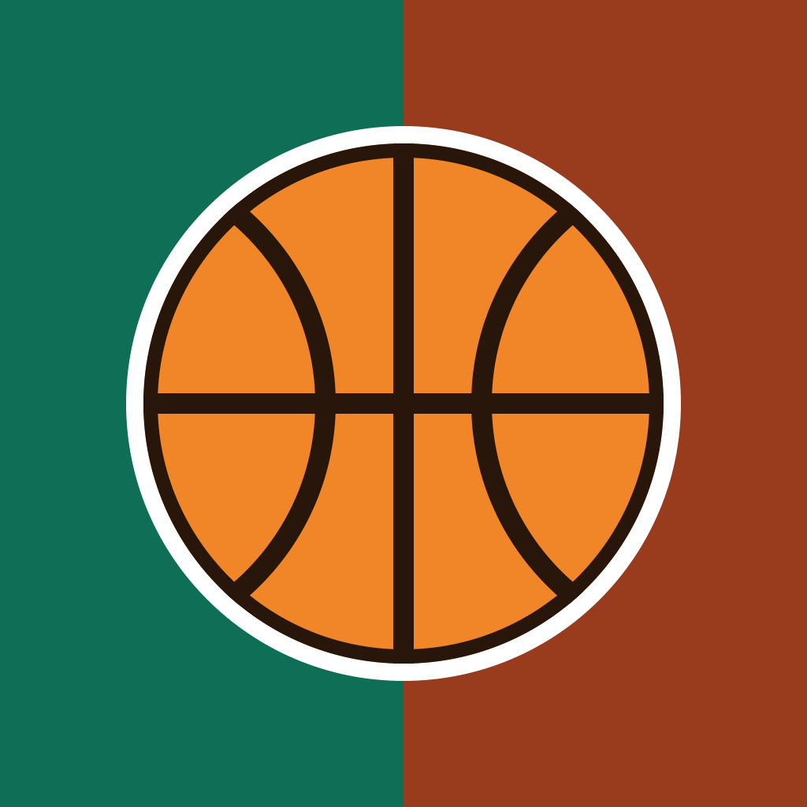
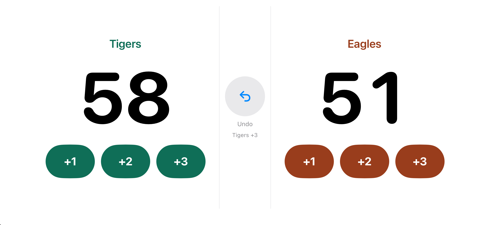

  

# Spielstand

A simple basketball scoreboard for the iPhone. Tap +1, +2 or +3 for either team, and both scores stay big and visible the whole game.

## Features

- **Two teams side by side:** each team has its own +1, +2 and +3 buttons and a large score.
- **Team names:** tap a name to change it ("Home" and "Guest" by default).
- **Undo:** takes back the last points, one step at a time, for either team. A small label under the button shows what the next undo will remove, e.g. "Tigers +3".
- **Reset:** sets both scores back to 0 after asking first. Team names stay.
- **Landscape only:** the layout is made for holding the phone sideways at the edge of the court.
- **Screen stays on** while the app is open, so it doesn't go dark during a game.
- **No data collected:** no accounts, no network access, no tracking.

## Requirements

- iPhone with iOS 18 or later
- Xcode to build (tested with Xcode 27)

## Build and run

1. Clone the repository and open `Spielstand.xcodeproj` in Xcode.
2. Select the **Spielstand** target, open **Signing & Capabilities**, and choose your own team under **Team**. You may also need to change the bundle identifier (`de.slania.Spielstand`) to one of your own.
3. Pick an iPhone or a simulator and press **Run** (⌘R).

## Project layout

| Path | What it is |
| --- | --- |
| `Spielstand/SpielstandApp.swift` | App entry point |
| `Spielstand/ScoreboardView.swift` | The scoreboard screen |
| `Spielstand/ScoreModel.swift` | Scores, team names and undo history |
| `Tools/make_icon.swift` | Script that draws the app icon (`swift Tools/make_icon.swift <output.png>`) |
| `AppStore/` | App icon and screenshot for the App Store listing |

## App Store screenshots

Debug builds accept a `-screenshotDemo` launch argument that fills in a game in progress (Tigers 58, Eagles 51). Release builds always start at 0–0.

## License

MIT — see [LICENSE](LICENSE).
